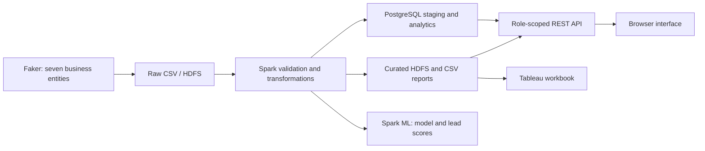
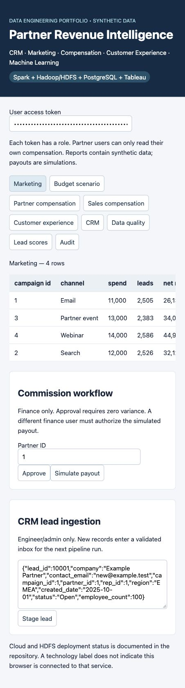
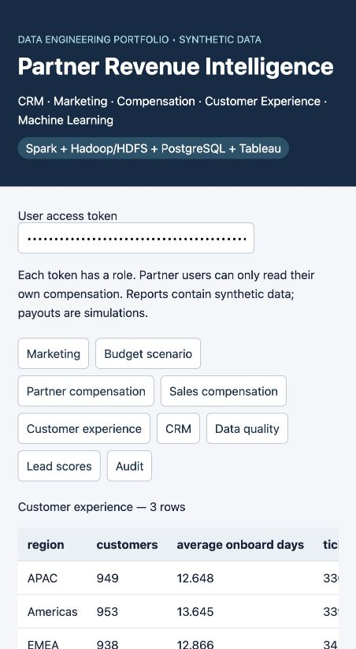
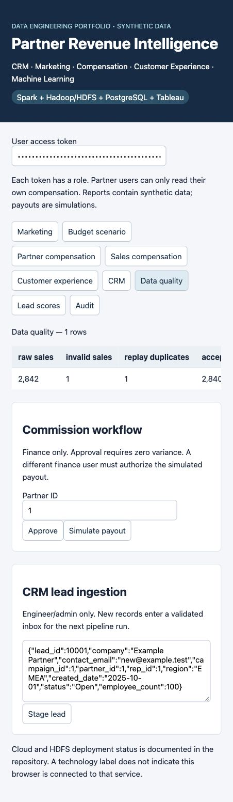

# Partner Revenue Intelligence

An end-to-end data platform connecting CRM leads, marketing campaigns, partner sales, commissions and customer support. It turns Faker-generated business records into validated reports, role-scoped APIs, Tableau workbooks and lead-conversion scores.

**Stack:** Hadoop/HDFS · Spark & MLlib · PostgreSQL · Tableau · Python/Faker · REST APIs · AWS CloudFormation

## Architecture



## Features

| Area | What the application provides |
|---|---|
| CRM | Validated lead staging, duplicate protection and regional Open/Won pipeline reporting |
| Marketing | Campaign conversion, attributed revenue and a fixed-total budget allocation scenario |
| Partner compensation | Booked-versus-calculated reconciliation, partner-scoped statements and unpaid-balance calculations |
| Finance workflow | Separate approver/payout identities, replay protection and simulated payouts |
| Sales incentives | Monthly quotas, attainment and progressive commission rates |
| Customer experience | Regional onboarding, CSAT, resolution time and SLA breaches |
| Data engineering | HDFS ingestion, typed Spark pipelines, quarantine, deduplication and lineage |
| Machine learning | Time-split logistic regression, evaluation metrics and batch lead scores |
| Security | Six roles, hashed user tokens, partner row isolation, audit records and optional HTTPS |
| BI and cloud | Packaged Tableau workbook, PostgreSQL integration, AWS infrastructure and daily-refresh code |

[Full feature catalog](docs/FEATURES.md) · [API and role reference](docs/API.md) · [Metric definitions](docs/METRICS.md)

## Screenshots

Screenshots show the local browser interface. Wide report tables scroll horizontally; complete values are available in the [report CSVs](data/curated/).

<details open>
<summary>Marketing performance</summary>



</details>

<details>
<summary>Customer experience</summary>



</details>

<details>
<summary>Data-quality reconciliation</summary>



</details>

## Verified results

| Check | Local result |
|---|---|
| Functional and business-rule tests | **11 passed** |
| Main dataset | **10,000 leads; 2,840 accepted sales** |
| Sales reconciliation | **2,842 raw = 2,840 accepted + 1 invalid + 1 duplicate** |
| Hadoop/HDFS | **HEALTHY**, with Spark reading and writing HDFS |
| Larger batch | **100,000 leads in 66.13 seconds** on a single host |
| ML holdout ROC AUC | **0.5716**, versus a constant-score baseline of **0.5** |
| ML split | **7,063 training / 1,870 holdout rows** |
| API and TLS | Eight report endpoints checked; access isolation and verified HTTPS tested |

Results use synthetic data. The batch timing is a local measurement; model metrics do not establish real-world predictive performance.

[Validation record](VALIDATION.json) · [HDFS check](docs/HDFS_FSCK.txt) · [ML metrics](docs/ML_METRICS.json) · [Benchmark](docs/BENCHMARK.json)

## Quick start

Requires **Python 3.11** and **Java 17**. From the repository root:

```bash
python3 -m venv .venv
source .venv/bin/activate
pip install -r requirements.txt
python generate.py --leads 10000
spark-submit --master 'local[2]' pipeline.py
spark-submit --master 'local[2]' train.py
python scripts/export_reports.py
python scripts/provision_user.py demo admin --token-file state/demo-token
PORT=8001 python server.py
```

Open **http://127.0.0.1:8001** and enter the token from `state/demo-token`. This quick start uses local CSV reports. For HDFS, PostgreSQL, HTTPS and Tableau setup, see the [setup guide](docs/SETUP.md).

Run tests with `python -m unittest discover -s tests -v`.

## Current status

- Local HDFS, Spark, ML, APIs and access-control tests have run successfully.
- PostgreSQL integration and Linux CI are implemented; runtime validation is still pending.
- The Tableau workbook is packaged and structurally checked; native rendering is unverified.
- AWS infrastructure passes static validation. Deployment is on hold; no AWS resources were created.
- Payouts are simulations. The deployment is single-host, with HDFS replication set to 1.

## Documentation

[Feature catalog](docs/FEATURES.md) · [API and roles](docs/API.md) · [Metric definitions](docs/METRICS.md) · [Setup](docs/SETUP.md) · [AWS operation](cloud/README.md) · [Delivery notes](docs/DELIVERY.md) · [JD mapping](docs/JD_COVERAGE.md)
